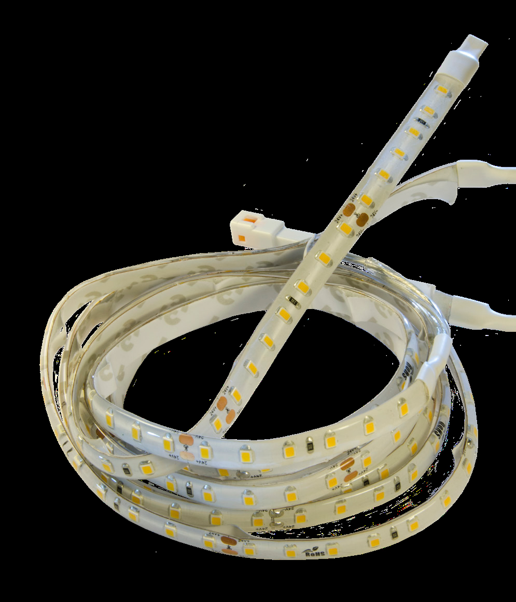

# Ficha técnica: Kit iluminación juego de brazos invisibles Concept

Ficha técnica de Gaviota, de una página, sacada de `raw/gvt/motores_y_automatismos/iluminacion_led/fichas/SPA - FICHAS TECNICAS TIRAS/SPA - FICHA TECNICA KIT ILUMINACIÓN J.BRAZOS INV. CONCEPT.pdf`. Los datos son los de la ficha, tal como vienen; al final, lo que no cuadra con el ERP o la tarifa.

## Especificaciones técnicas

| Característica | Valor |
| --- | --- |
| Descripción | Kit Iluminación J. Brazos Inv. Concept |
| Voltaje | 24 VDC |
| Consumo | 8 W/m |
| Temperatura | 3200 K |
| LED/m | 480 |
| Longitud tramo (distancia entre cortes) | 5 cm |
| Flujo luminoso | 850 lm/m |
| Protección | IP 67 |
| Tipo | SMD |

## Referencias

| Referencia | Descripción | Longitud (m) |
| --- | --- | --- |
| 80081913 | Kit Iluminación J. Brazos Inv. Concept 1,50M | 1,5 |
| 80081914 | Kit Iluminación J. Brazos Inv. Concept 1,75M | 1,75 |
| 80081860 | Kit Iluminación J. Brazos Inv. Concept 2,00M | 2 |
| 80081915 | Kit Iluminación J. Brazos Inv. Concept 2,25M | 2,25 |
| 80081861 | Kit Iluminación J. Brazos Inv. Concept 2,50M | 2,75 |
| 80081916 | Kit Iluminación J. Brazos Inv. Concept 2,75M | 3 |
| 80081862 | Kit Iluminación J. Brazos Inv. Concept 3,00M | 3,25 |
| 80081917 | Kit Iluminación J. Brazos Inv. Concept 3,25M | 3,50 |
| 80081863 | Kit Iluminación J. Brazos Inv. Concept 3,75M | 3,75 |
| 80081887 | Kit Iluminación J. Brazos Inv. Concept 4,00M | 4 |

## Qué lleva el juego

La longitud es la medida del brazo. El juego lleva las tiras preparadas para los dos tramos (perfil trasero y delantero) de los dos brazos, de medidas distintas según la medida del brazo, y cables para llevar la conexión de las tiras a un lado u otro del toldo (usuario, 2026-11-01).

## Observaciones

Revisión de la ficha con el ERP (`raw/gvt/exports_articulos_ax/`) y la tarifa de iluminación Plug&Play 2025:

- Columna «Longitud (m)» desplazada desde la fila de 2,50 m: da 2,75 / 3 / 3,25 / 3,50 donde la descripción y el ERP dicen 2,50 / 2,75 / 3,00 / 3,25.
- 80081863: la ficha dice 3,75 m; el ERP, 3,50 m. Falta en la ficha el kit de 3,50 m (o sobra el de 3,75 m).
- La ficha no dice qué lleva el juego. Según el usuario (2026-11-01), la longitud es la medida del brazo; el juego lleva las tiras preparadas para los dos tramos (perfil trasero y delantero) de los dos brazos, de medidas distintas según la medida del brazo, y cables para llevar la conexión de las tiras a un lado u otro del toldo.
- Tipo SMD (la foto lo confirma: leds separados), a diferencia de las demás tiras, que son COB.
